<!-- Generated from scripts/architecture/templates/README.md.in by scripts/generate_architecture.py. Edit the template, not this file. -->

# ArdvarkFood

<p align="center">
  
</p>

<p align="center">
  
  
  
  
</p>

<p align="center">
  <a href="https://github.com/TheWildKaden/ArdvarkFood">Repository</a>
  ·
  <a href="https://github.com/TheWildKaden/ArdvarkFood/issues">Issues</a>
  ·
  <a href="https://github.com/TheWildKaden/ArdvarkFood/graphs/contributors">Contributors</a>
</p>

---

## About

ArdvarkFood is a FastAPI application with Ardvark chat and a local SD-Turbo
image generator. Its existing app also mounts a modular LLM and agent runtime
under `/api/runtime`; the runtime does not replace the original chat, image, or
encoding modules.

The static project site can be published with GitHub Pages or Cloudflare Pages.
For fork and hosting setup, see [FORKING.md](./FORKING.md). To preview the
interactive Ardvark frontend and its API locally, run
`./scripts/start-dev-preview.sh` (or the **Start Ardvark Dev Preview** task in
VS Code), then open `http://localhost:8000`. The app serves the existing chat
and image-generator frontend at `/` and the Pages-style project overview at
`/project`. Build the static site with `npm run build:pages`; preview it with
`npm run preview:pages` at `http://localhost:4173`.

## Project layout

- `app.py` remains the stable ASGI/CLI entry point (`uvicorn app:app`).
- `src/web/` contains the FastAPI factory, API routes, request schemas, and
  chat-provider service; these are separated from model and agent runtimes.
- `AI-Runtime/` owns LLM adapters, agent orchestration, tools, permissions,
  memory, and runtime persistence.
- `local_image_generator.py` owns the independent local image model adapter.
- `src/encoding/` retains the original message-encoding implementation.
- `static/`, `docs/`, and `frontend/` hold the interactive app UI, static
  project site, and separately maintained frontend source, respectively.
- `tests/` contains application and runtime integration tests.

## Architecture

This architecture is regenerated from the checked-out source. Imports and
literal route declarations are parser-detected; direct calls are resolved only
when the local target is unambiguous. Dynamic dispatch and external runtime
behavior are not claimed as detected facts.

The diagrams below are local SVG previews; every one links to its editable Mermaid source.

<details>
<summary>Project structure · <a href="docs/architecture/project-structure.mmd">Mermaid source</a></summary>


</details>

<details>
<summary>Declared dependencies · <a href="docs/architecture/dependencies.mmd">Mermaid source</a></summary>


</details>

<details>
<summary>Module and package imports · <a href="docs/architecture/modules.mmd">Mermaid source</a></summary>


</details>

<details>
<summary>Detected local call graph · <a href="docs/architecture/call-graph.mmd">Mermaid source</a></summary>


</details>

<details>
<summary>Class inheritance · <a href="docs/architecture/class-relationships.mmd">Mermaid source</a></summary>


</details>

<details>
<summary>Message lexer/parser and encoder · <a href="docs/architecture/lexer-parser.mmd">Mermaid source</a></summary>


</details>

<details>
<summary>Detected API routes · <a href="docs/architecture/api-architecture.mmd">Mermaid source</a></summary>


</details>

<details>
<summary>LLM and model runtime · <a href="docs/architecture/llm-runtime.mmd">Mermaid source</a></summary>


</details>

<details>
<summary>Agent execution loop · <a href="docs/architecture/agent-execution.mmd">Mermaid source</a></summary>


</details>

<details>
<summary>Tool permission gates · <a href="docs/architecture/permissions.mmd">Mermaid source</a></summary>


</details>

<details>
<summary>Persistent runtime storage · <a href="docs/architecture/storage.mmd">Mermaid source</a></summary>


</details>

<details>
<summary>Build and deployment pipelines · <a href="docs/architecture/build-pipelines.mmd">Mermaid source</a></summary>


</details>

Regenerate locally with `npm ci`, `npx puppeteer browsers install chrome`, and `npm run architecture:generate`. The source and dependency analysis uses Python AST and Babel; unsupported or dynamic relationships are omitted or explicitly marked as inferred.

### Technology stack

- **Python**
- **FastAPI**
- **Pydantic**
- **httpx**
- **llama.cpp Python binding**
- **PyTorch**
- **Diffusers**
- **React source**
- **Fastify source**
- **SQLite**
- **Node.js**
- **Mermaid CLI**
- **Babel parser**

## LLM and agent runtime

The runtime defaults to local GGUF inference through `llama.cpp`. No model
weights are bundled. Install the optional runtime dependencies and provide a
GGUF model:

```bash
pip install -r AI-Runtime/requirements.txt
export AI_RUNTIME_MODEL_PATH=/path/to/model.gguf
uvicorn app:app --host 0.0.0.0 --port 8000
```

`POST /api/runtime/models/load` loads the configured model; use
`POST /api/runtime/models/unload` to release it. Model settings can be supplied
through environment variables or `AI-Runtime/config/settings.json`. An
OpenAI-compatible backend is available only when explicitly selected with
`AI_RUNTIME_BACKEND=openai_compatible` and configured with
`AI_RUNTIME_BASE_URL` (and, if needed, `AI_RUNTIME_API_KEY`). The existing
`/api/chat` endpoint remains unchanged.

The agent keeps inference separate from orchestration. It builds conversation
context, invokes the model, validates any function-call arguments against JSON
Schema, checks permissions, dispatches tools, records results, and continues
until a final response or a configured limit. Built-in tools cover confined
workspace file access, restricted read-only terminal/git commands, approved
Python subprocesses, allowlisted HTTPS fetch/API calls, and configured stdio
MCP servers. Custom tools can be registered through the runtime's Python
`ToolRegistry` interface.

Tools are not executed directly by model output. Reads are approved by default;
write, network, terminal, Python, and MCP operations wait for an explicit
approval. The approval request is emitted as an SSE event and can be resolved
with `POST /api/runtime/executions/{execution_id}/tools/{tool_call_id}/approval`.
Python execution runs in a separate interpreter process but is **not** an OS
sandbox; only grant approval in a trusted, private deployment. Network tools
require an explicit `outbound_allowed_hosts` allowlist in runtime settings.
Keep the API private to trusted users.

Runtime API endpoints:

- `POST /api/runtime/chat` — agent chat; set `"stream": true` for SSE tokens,
  tool events, approval requests, and final status.
- `GET/POST /api/runtime/conversations` and
  `GET/DELETE /api/runtime/conversations/{id}` — persisted conversations.
- `GET /api/runtime/models`, `POST /api/runtime/models/load`, and
  `POST /api/runtime/models/unload` — model lifecycle and status.
- `GET /api/runtime/tools`, `GET /api/runtime/executions/{id}`, and
  `POST /api/runtime/executions/{id}/cancel` — tool discovery and run state.
- `GET /api/runtime/config` and `POST /api/runtime/memory` — effective safe
  configuration and explicit long-term memory writes.

SQLite stores conversations, messages, execution state, tool events, memory,
and audit records under `AI-Runtime/storage/` by default. Interrupted runs are
marked when the runtime restarts. Text and PNG/JPEG/WebP image attachments are
accepted; image inference requires a compatible multimodal GGUF model and CLIP
projector. Audio and video are rejected with an explicit unsupported-modality
error. The existing SD-Turbo image-generation endpoint remains a separate
local image pipeline.

## Features

- FastAPI chat and a local open-weight SD-Turbo image generator.
- Integrated GGUF/open-compatible LLM adapters and a permissioned tool-using
  agent loop.
- Persistent conversation, execution, memory, and audit storage.
- The original DeepSeek message-encoding implementation remains in
  `src/encoding/`.

See [SOURES.TXT](./SOURES.TXT) for upstream model, runtime, and framework
references.

## Statistics

<p align="center">
  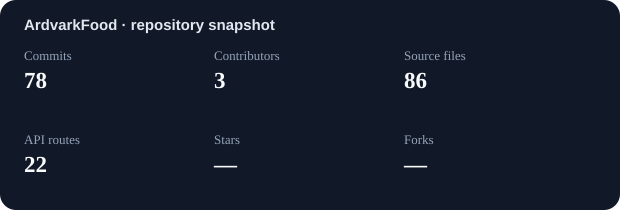
</p>

The snapshot uses local git history and source-analysis counts. Stars and forks
are refreshed from the GitHub API when available; the generated image and JSON
remain in the repository so the README does not rely on a remote stats image
service.

## Contributors

Want to contribute? See the [contribution guide](./CONTRIBUTING.md), open an
[issue](https://github.com/TheWildKaden/ArdvarkFood/issues), or submit a pull request. Contributor cards
use repository-local SVG avatars. GitHub usernames and contribution totals are
read from the contributors API when available; otherwise local commit author
names are used without publishing email addresses.

<table>
<tr><td align="center"><br /><sub>Tide Sync Bot<br />47 contributions</sub></td><td align="center"><br /><sub>Vlint<br />7 contributions</sub></td><td align="center"><br /><sub>AcHamm<br />1 contributions</sub></td></tr>
</table>

---

<p align="center">
  <sub>Built by <a href="https://github.com/TheWildKaden">TheWildKaden</a></sub>
</p>
