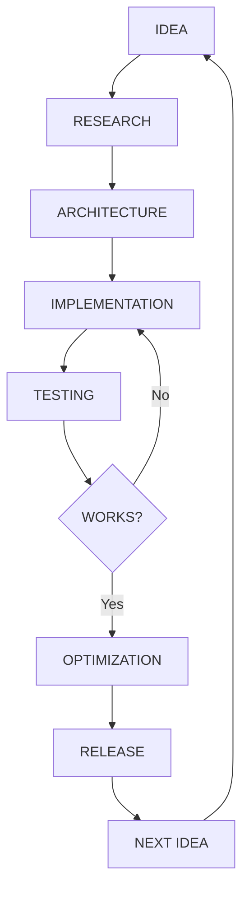

 

 

---

## `01` — WHO AM I?

I'm a developer interested in building software that pushes beyond conventional boundaries.

I work across software engineering, artificial intelligence, operating systems, automation, and application architecture.

I enjoy taking complicated ideas, breaking them into systems, and turning them into working software.

**I don't just want to use technology. I want to understand how it works and build my own.**

---

## `02` — TECHNOLOGY STACK

### Languages

### Frameworks & Development

### Systems & Infrastructure

---

## `03` — FEATURED PROJECTS

### Other areas I'm building in

| Area | Focus |
|---|---|
| AI Systems | Agents, autonomous workflows, LLM runtimes |
| Operating Systems | Custom environments, desktop systems, Linux |
| Developer Tools | Compilers, automation, CLI utilities |
| Application Development | Interfaces, APIs, modular applications |
| Game Technology | Mods, tooling, custom integrations |

---

## `04` — ENGINEERING MINDSET

My development principles:

- Modular architecture over unnecessary complexity.
- Performance without sacrificing maintainability.
- Automation wherever it makes sense.
- Experimentation and continuous learning.
- Understanding systems instead of blindly depending on them.

---

## `05` — GITHUB ACTIVITY

---

## `06` — CURRENT DIRECTION

Exploring the intersection of:

- Autonomous AI and self-improving software.
- Multi-language runtime architectures.
- Low-level systems engineering.
- Custom operating systems and desktop environments.
- Developer experiences and automation.

---

### BUILD. BREAK. UNDERSTAND. REBUILD.

**The best projects start as ideas that seem impossible.**

 

  

Designed and maintained by TheWildKaden

